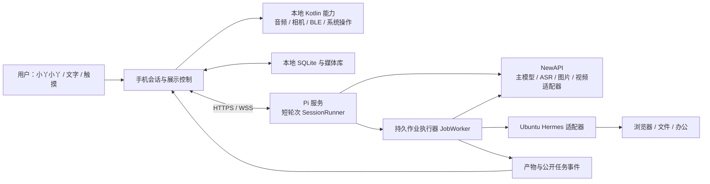

# 小丫架构：持续对话、内容展示和可扩展工具

日期：2026-10-27。状态：架构决策与待实现设计；代码现状以 [STATUS.md](STATUS.md) 为准。
需求优先级：[本次用户需求](PRODUCT-REQUIREMENTS.md) → 本文 → [APK 开工补充](APK-DEVELOPMENT-PLAN.md)与 [Pi 基线](PI-AGENT-PLAN.md)。冲突时按这个顺序修订；已验证的硬件限制仍须保留。

## 1. 架构结论与语言选择

继续改造现有 My LOOI，保留全屏眼睛、表情动画、BLE、相机基础、PCM 音频、本地记忆与 APK 更新。现有表情可复用，现有 Realtime 对话不能直接等同于已支持本项目中转模型。

| 部分 | 选型 | 选择依据 |
| --- | --- | --- |
| 手机界面与应用编排 | React Native / Expo / TypeScript | 沿用现有资产；实现对话、Viewer、任务框与配置，不重写已有 App |
| 手机原生能力 | Kotlin + Expo Modules | 统一音频采集、KWS、相机录像、BLE、播放器/系统分享；高频帧与 PCM 留原生层，避免逐帧塞 React 状态 |
| Pi 服务 | Node.js >=22.19 / TypeScript；Pi 两个核心包固定 1.4.0 | 与手机协议共用类型；单进程异步 I/O 适合对话、事件和任务编排 |
| 持久化 | 手机 SQLite + 服务 SQLite/WAL；文件独立目录 | 首期单用户单设备不引入 Redis、消息队列集群或多层微服务 |
| Ubuntu 办公执行 | 复用现有 Hermes，使用其真实 API/适配器 | 不另造浏览器/办公智能体，不把 SSH/root 凭据放手机 |
| 后续导航算法 | 先独立 Kotlin/ARCore demo；必要时复用 C++/局域网 ROS 2 原型 | 不把整个导航栈作为聊天 APK 的首版依赖，不先重写成熟算法 |

2026-10-30 导航选型补充：先验证小米 12 Pro 的 ARCore VIO/深度，主候选为 RTAB-Map 持久建图与重定位，再接本地规划和 LOOI 控制；不先购买雷达。具体边界与逐步验收见 [手机优先导航方案](PHONE-FIRST-NAVIGATION.md)，当前仍为待开发原型。

首版是 **一个手机应用 + 一个模块化 Pi 服务 + 现有 Hermes**。不为模型调用另写 Go/Rust 服务，不新增 Python 网关；未来算法已有 C++/Python 组件时通过边界复用。

## 2. 运行与数据流



手机自主承担感知、展示、媒体、本地动作和已验证的短周期控制；普通推理可经 Pi 调中转。手机内嵌 Pi 仍需独立验证 Metro/Hermes JS 引擎，不因“希望尽可能本机”就假定 SDK 可直接嵌入。依赖服务器的能力在离线时如实降级，本地 STOP、已保存媒体和已实现本地按钮不跟随云端失效。

## 3. 必须新增的模块与职责

| 模块 | 职责及禁止耦合 |
| --- | --- |
| SessionRunner | 每个会话单一串行输入队列、Pi 工具循环、上下文摘要、代次取消；不等待数分钟视频或办公任务 |
| ProviderRegistry | 文字、ASR、TTS、文生图、图生图、文生视频、图生视频分别声明协议和能力；不按模型名称猜端点 |
| ToolRegistry | JSON Schema、执行位置、权限、超时、副作用/资源声明；能力通过验证后才注册给 Pi |
| DeviceBridge | 认证配对、设备能力、V1 幂等请求/结果、重连与过期控制；沿用开工方案的协议语义 |
| JobWorker | SQLite 作业、提交、状态、事件、取消及重启恢复；媒体/Hermes 在此运行，不堵会话 |
| ArtifactStore | 原始文件、派生版本、校验、缩略图、预览文件、任务归属和引用有效期 |
| PresentationManager | 当前视图、显示队列、固定、计时、语音打开/关闭；不删除文件，不取消后台任务 |
| ResourceCoordinator | 相机/麦克风/输出与 App 生命周期；所有恢复入口都受占用/代次约束 |
| MotionController | 唯一 BLE 写入仲裁、本地停止、有限动作/跟随/导航模式；Pi 只发送高层意图 |
| ExtensionRegistry | 文件分享、邮件及将来的外部操作；权限、账户授权与投递状态独立于聊天 |

保留当前 `mobile/` 工作区。拟新增 `agent-service/src/{sessions,providers,bridge,jobs,artifacts,adapters,extensions}`、`mobile/src/{agent,artifacts,presentation,extensions}`，在现有 device-tools、memory、voice 与 modules 中扩展。协议以版本化 JSON Schema 和生成的 TypeScript 类型共享；先不移动上游代码或重排锁文件。

## 4. 表情、媒体、任务框是三个展示模式

| 模式 | 主区域 | 表情位置 | 会话与计时 |
| --- | --- | --- | --- |
| face | 全屏表情 | 主角 | 持续监听/对话；按真实事件切换表情 |
| viewer | 图片、视频、PDF、Word/PPT 的预览 | 主表情被内容覆盖 | 会话继续；左上固定、右上 X、右下倒计时 |
| task | 用户草图中的执行框：步骤、工具活动、截图/产物 | 右下角小表情 | 任务和会话并行；可切回 face，任务继续 |

先沿用当前 `app.json` 的横屏，与草图的主区域/右下小表情对应；未来竖屏做自适应，不用旋转整张任务画面模拟布局。右下小表情是应用内组件，不需要 Android 悬浮窗权限。

**“表情进入后台”解释为同 App 里的展示层被覆盖，不能触发 Android 后台退出。** KWS、会话和任务事件仍按资源状态运行。真正 Home/锁屏/外部 App 属系统生命周期，首版仍按前台范围验收，另处理录像封装及 Activity lease。

当前 `ImageOverlay.tsx` 只有 3 秒自动关闭，点击任意位置关闭，没有固定按钮；它不能满足新需求。后续用统一 PresentationManager 替代，避免每类文件各写一套 timer。

### Viewer 的可判定规则

1. 图片/文档首次成功可见才开始 10 秒，加载失败不空白倒计时；用户正在缩放、翻页或拖动时暂停计时，交互结束后重新给足 10 秒。此交互暂停是本次补充默认项。
2. 视频正常播放不触发关闭；由真实 ended 事件启动额外 10 秒，符合“视频长度 + 10 秒”且不被缓冲、暂停或拖动截断。时长未知时显示“播放中”，不编造倒计时。
3. 固定或语音“固定这张图”取消关闭计时；解除固定，图片重新 10 秒，视频未结束则继续等结束。固定不代表重复播放，也不改变文件保留策略。
4. X/语音“关掉这张图”立即回 face；只关闭当前 viewId，不删产物、不取消生成任务、不停止所有语音。界面返回按钮同样处理。
5. 每个显示实例具有独立 viewId。旧内容的 timer、播放器回调、下载完成不得关闭/覆盖新内容；后台回来按当前状态恢复，不延续过期回调。
6. 用户主动“调出刚才图片”可替换当前内容；自动完成的新结果在用户固定、阅读、播放或操作时只入队提示。任务事件不反复强制打开大框。
7. 固定是当前查看状态，首版仅在当前会话/前台生命周期生效；重启恢复文件与任务入口，不自动播放旧视频或恢复长时间录制。

Word/PPT 首先保留原文件，经 Hermes/可用转换服务转 PDF 或逐页图片后在 App 中预览；原文件可下载/分享。服务不可用时调用手机已安装的查看器，明确这会切出应用，不承诺保留实时监听。不要把“能打开 Office 文件”误当作手机必须内置完整 Office 编辑器。

## 5. 照片与生成结果形成可引用的版本链

Artifact 至少包含：`artifactId`、`kind`、`mime`、`ownerDeviceId`、`taskId`、`createdAt`、`parentArtifactIds`、`revision`、本地/服务端 locator、文件 hash、预览状态与有效期。`kind` 与 MIME 校验一致；本地 URI 不直接塞给模型。

会话上下文区分 `selectedArtifactId`、`lastCapturedArtifactId`、最近确认的输出；查看顺序与完成顺序不直接覆盖用户选择。每次编辑新建产物，保留原图和中间版本；生成视频明确记录引用的图片版本。

```text
“拍张照片” → photo_A
“这个表情换成笑脸” → image_edit(photo_A) → image_B
“让这个人跳舞” → image_to_video(image_B) → job_C → video_C
“调出刚才照片” → 按本会话指代与媒体类型检索，必要时列候选
```

“让人跳舞”按图生视频处理；“改表情”在看图上下文通常指照片人物表情，不自动更换机器人皮肤。有多人或多个合理图片目标时澄清对象；目标唯一时不重复打断用户。图片由手机明确选中/拍摄后才按该任务上传，统一上传适配负责 data URL、multipart 或短时签名 URL 的转换，以真实供应商协议为准。

## 6. 长任务不会占住聊天

Pi 只做任务理解与短工具调用。`task_submit` 先写作业并返回 taskId/queued，回答“正在处理”；JobWorker 独立调用媒体/Hermes，持久化 providerTaskId 后跟踪。完成后产物事件进入手机队列，播报也排入会话队列，不直接抢占当前用户发言。

Agent 每个会话串行，首版 `toolExecution: "sequential"`；外部作业与其他会话可以受限并发。初始建议单用户最多一个视频生成、一个 Hermes 办公任务同时运行，其余排队；这是可配置资源预算，不是供应商能力承诺。

任务保留 input artifact、幂等键、外部任务 ID、重试次数、取消请求、公开事件与最终结果。媒体提交超时但可能已受理时进入待核实，先查原任务，不自动重新付费生成。provider 不提供取消时显示“已停止等待，远端可能继续”，不能把关面板当已停止远端。

`stop_speaking`、`cancel_turn`、`cancel_job`、`camera_stop_recording`、`robot_stop` 分开实现。普通对话默认 90 秒预算不结束已经建立的录像或生成作业；本地运动时限由 MotionController 管，不继承模型回答时长。

## 7. 指定中转、中文语音与童声

| 用途 | 选择 | 当前证据 |
| --- | --- | --- |
| 主对话/看图/工具 | `agnes-3.0-flash`，`https://apichat.jiazhuangai.com/v1` | 本次模型可见、文字成功；工具/SSE/看图为此前 HTTP 小样本，Pi SDK 仍待验收 |
| 图片生成/编辑 | `agnes-image-2.5-flash` | 文生图此前通过；图生图图片字段与一致性还未测试 |
| 视频生成/图生视频 | `agnes-video-2.5` | 模型可见；提交/查询/取消/引用图片和产物下载仍待验证 |
| 中文 ASR | `TeleAI/TeleSpeechASR` | 此前合成中文 WAV 通过；真实手机远场另测 |
| 当前声音与未来可选童声 | 手机系统中文 TTS；未来候选 Azure `zh-CN-XiaoyouNeural` | 2026-10-28 用户确认当前声音够用，Azure 调为最低优先级、现在不接入，也不要求提供 Azure 配置 |
| TTS 降级 | Android 当前引擎提供的中文 voice | 待实机 `getVoices()`；不能保证系统自带童声 |

用户已选的 TTS 音色依据 [Azure 官方音色表](https://learn.microsoft.com/en-us/azure/ai-services/speech-service/language-support?tabs=tts)，认证和区域音色表见 [TTS REST](https://learn.microsoft.com/en-us/azure/ai-services/speech-service/rest-text-to-speech)。标准 Xiaoyou 音色没有列出 cute 风格，不套用别的音色 style 参数；“可爱”以接入后试听为准。换供应商/音色只变 TtsProvider 配置，不改会话核心；Azure 凭据不进入 APK。

固定唤醒词 **小丫小丫**。先评估现有 sherpa-onnx 原生桥配中文 KWS 模型，重新生成 token/关键词并做远场、同音和误触发测试，不能只把 UI 名字改掉。官方有中英 3M/中文 3.3M 的自定义关键词模型可研究，[模型与 token 规则](https://k2-fsa.github.io/sherpa/onnx/kws/index.html)。离线“停止运动”单独验证，不用云端 ASR 代替。2026-10-27 用户允许录像改为手动停止，录制时暂停识别、结束后恢复。

同一 PCM 生产者供 KWS、VAD、分段 ASR 和需要的录像音轨；手机原生层做分流，队列背压和丢帧状态可观测。TTS 以标点/短句分段播报，generationId 作废后清队列，防止旧回答续播。中文模型是按能力下载，不能作为进入全 App 的前置条件。

## 8. Hermes 适配：复用真实服务能力

用户已确认 NousResearch Hermes `v0.21.6+199.g1744a19`，直接安装于 Linux，通过 systemd 用户服务 hermes-gateway.service 启动；底层 custom/gpt-6.1-sol 的凭据留服务器。已提供 `https://hermes.jiazhuangai.com`，健康、鉴权与四项 Runs 能力通过。手机已实现 SecureStore 连接设置、文字派单、SQLite 恢复、SSE 执行面板与停止请求；实际 TypeScript 客户端已完成真实任务/幂等/SSE 联调。首轮手机直接连接 Hermes，正式 Pi 转接随后接入；手机网络与原生行为仍待真机验收。具体契约见 [HERMES-INTEGRATION.md](HERMES-INTEGRATION.md)。

优先流程：能力发现 → 幂等提交 run → 持久化外部 run_id → 事件/状态 → 取消 → 产物导入。当前官方文档描述 `GET /v1/capabilities`、`POST /v1/runs`、状态/事件和 stop；插件按运行服务发现结果接线，不依赖私有 Python 内部结构。[官方 API 文档](https://hermes-agent.nousresearch.com/docs/user-guide/features/api-server)

没有 Runs API 但能流式聊天的版本，用服务端 adapter 包装成自己的持久 Job；没有可远程调用 API 时再增服务器本地窄接口。不要直接将 Ubuntu 终端当作模型在手机上的任意执行入口。Hermes 和 Pi 分别保存自己的会话 ID，通过 taskId 关联，办公任务使用独立子会话，避免长工具堵住小丫日常聊天。

任务框展示公开计划摘要、步骤/工具名、开始与结束、错误、真实截图和产物；不展示原始隐藏推理，不把成功提交写成已完成。供应商返回 reasoning 字段也不直接复制为产品日志，摘要和执行事实分开。

**文件和画面是单独集成项。** 用户版本文档有非图片文档上传限制，main 与该版本的 browser/artifacts 路由又有差异；不能写死一个假想下载路由。先检查实际服务，再通过共享受限工作目录/下载接口把文件导入 ArtifactStore；手机拿到受鉴权 URL，而不是 Ubuntu 任意路径。浏览器 Screen 若无原生事件/画面流，先做步骤+定时真实截图，有能力再做屏幕流。优先同 Ubuntu 的 Pi→Hermes loopback，手机仅连接 Pi；3x-ui 管理地址不作为 API。

派单包含目标、必要上下文、输入 artifact、预期产物、超时、允许能力与 requestId；失败返回明确原因。能力路由先选择已实现本地工具，再选择媒体服务或 Hermes；需要补信息才询问用户，不让手机/Hermes相互无限转派同一任务。

## 9. 权限与未来微信/邮件扩展

将用户的“最大权限”落实为**能力尽可能完整、逐项可授权和可扩展**。普通 APK 的运行时/特殊/签名权限不同，不能一次授权后获得系统及所有 App 权限。[Android 权限机制](https://developer.android.com/guide/topics/permissions/overview)

扩展契约建议包含：`id/version`、能力名、输入/输出 schema、执行位置（手机/服务/Hermes）、所需 Android 权限和账户 scope、健康检查、超时/取消、幂等语义、任务事件与结果。第一版编译期注册受控适配器；日后有需要再增加 MCP 适配，不从远程下载任意 JS/Kotlin 在手机执行。

- **微信第一步**：通过 Android Sharesheet 分享已生成文件，让用户在微信中选择目标并发送；不能把唤起分享页当作“已发给某某”。[系统分享与文件授权](https://developer.android.com/develop/ui/compose/sharing/send)
- **指定微信联系人自动发送**：需要确实可用的接入能力、联系人解析与结果回执；个人微信不预先承诺官方任意私聊发送接口。无障碍/UI 自动化仅作为用户单独启用的后续适配，系统允许权限也不等于界面永久稳定。
- **邮件**：可用授权邮箱 API/SMTP 的服务端适配，或手机邮件撰写页；撰写与发送分别返回状态。收件人唯一、文件与授权明确时按指令执行；歧义或任务新增外发目标时先确认对象，不每次重复要求已授权步骤。
- **账户与权限**：凭据存服务私有配置或手机 SecureStore；插件按账户及能力撤销。网页、附件和模型输出不能提升自己的发送/设备权限。

## 10. 运动、认人与导航的职责边界

语音前后左右与 STOP 放在首轮 BLE 到货验收，后续按顺序验证原地看人、认人/人体关联、单房间跟随、声源引导、地图重定位与去客厅。Pi 只调用经验证的 `robot_move_limited/follow_person/navigate_to_room`，持续速度控制与失效停止留手机。

小米 12 Pro 有官方 ARCore Depth 支持依据，但国行 OS3 的实际服务可用性、后摄视野、前后摄并发和底座俯仰外参均要先测。现有代码有社区推断的悬崖/前向 ToF 数据，不等于全屋地图，也不能说完全没有传感基础。详见 [本次导航研究与一手参考](NAVIGATION-RESEARCH.md)。

## 11. 修订后的开发顺序

| 阶段 | 交付 | 放行条件 |
| --- | --- | --- |
| S0 本轮修复 | 解除上游强制 Key/语音模型门槛；默认本地表情；旧 Realtime 独立选择 | 无 Key/无麦克风许可可进 App；本地模式不自动启动旧语音；切换模式释放资源 |
| S1 基线与协议 | 永久签名手机包、中文核心界面、Pi provider/假工具与 V1 设备桥 | 原生构建安装、SDK工具循环/取消、幂等重连、签名覆盖升级 |
| S2 图片闭环与 Viewer | 拍照/保存/10秒固定关闭/再调出；图生图 adapter | 原图与派生图关联正确；固定/倒计时不冲突；图片编辑真实接口通过 |
| S3 中文陪伴与媒体 | 中文 ASR、童声候选、固定唤醒、视频/录像播放器及音频协调 | 持续会话/打断；有声录像手动停止后恢复对话；视频结束再10秒；保存与恢复 |
| S4 异步生成与 Hermes | JobWorker、图生视频/视频生成、办公派单、任务大框与小表情 | 执行时仍聊天；真实事件/文件返回；取消/失败/重启恢复；不重扣费提交 |
| S5 身体与人物 | BLE 基线可到货后并行；有限动作、看人、身份/人体关联与跟随 | 每项有本机记录；相机/音频占用与运动仲裁成立 |
| S6 空间与扩展 | 手机 VIO/地图原型、去客厅、邮箱/微信插件 | 分别通过导航/账户/发送能力验证后启用，不等待全部功能才发布基础包 |

S2/S3 的相机与麦克风原型仍要在 S1 尽早交叉验证；表中是产品交付顺序，不表示拖到 S3 才发现资源冲突。导航独立原型可并行，不阻塞普通对话与媒体。

## 12. 当前需要补齐的信息

Hermes 地址/鉴权/能力及手机能力探测已通过，文件回传仍需开发；Pi 已内嵌手机主线。手机 Token 存 SecureStore。当前使用已试听通过的系统中文 TTS，用户不要求现在接入 Azure。图生图/图生视频仍需完成手机闭环。LOOI 已到货，第一次握手成功，重连和整机动作尚未通过。

这些信息分别解锁接口集成和实机验证；不阻塞本地门槛修复、Viewer 状态设计、产物模型与任务协议。本文没有把设计中的目录、接口或候选硬件标记为已实现。
