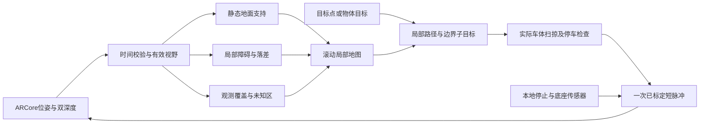
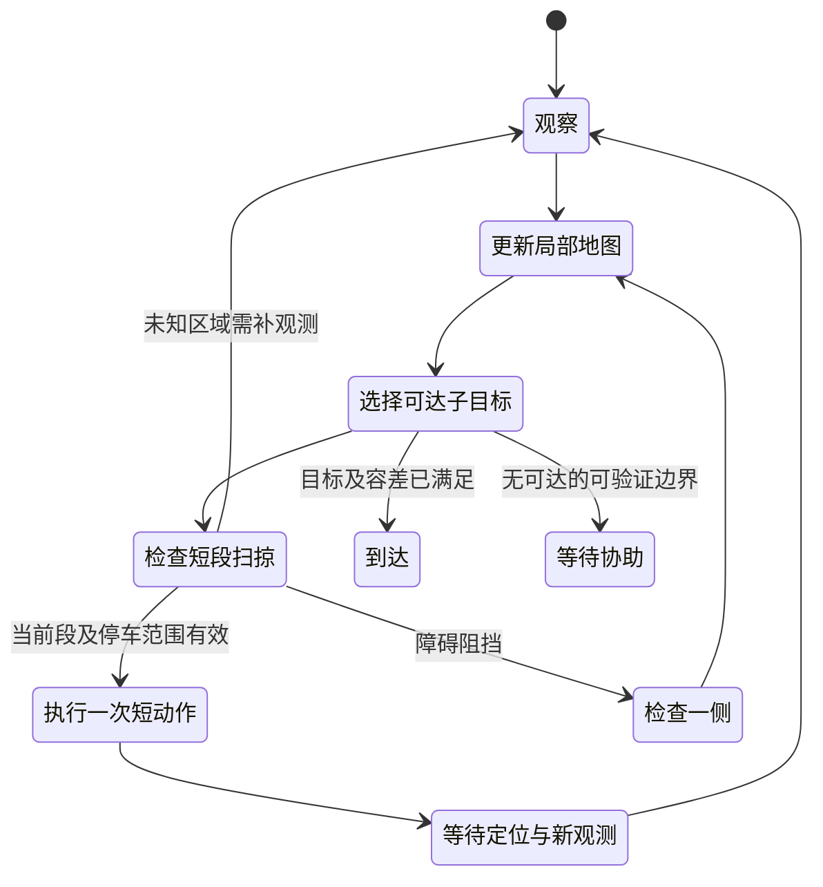

# 增量探索与局部绕障方案

2026-11-06修订。依据[候选为0的实数据审计](NAVIGATION-CANDIDATE-AUDIT-2026-11-06.md)，替代“先等完整地面圆盘候选，再讨论是否能走”的推进方式。本文是选定的后续实现方案，不将尚未开发的探索/绕障记成179已有功能。

实施进度：180已完成P0并通过真机回放。181新增P1会话局部分层地图、带朝向矩形及停止延伸扫掠，并接入P2的有界A*与可达边界路线预览；127项原生测试、完整CI和已安装手机的地图/点选目标无电机回放通过。路线预览无电机接口；P2的逐段实车执行、无进展退出，以及P3安装/脉冲/停车标定尚未完成，不能宣布自主绕障通过。见[181实现与保存数据结果](LOCAL-NAVIGATION-LAYERS.md)、[181真机结果](PHONE-CHECK-2026-11-09.md)和[180实测](PHONE-CHECK-2026-11-06-P0.md)。

## 目标与实现边界

先完成真实平整地面上的“看到目标，朝它分小段推进；发现障碍后检查一侧，分段绕过，再继续到目标”。不要求先建完整房间地图，也不要求全图候选大于0。未知只影响涉及该区域的动作，不阻止在其他已验证区域内规划。

保持现有TypeScript手机智能体、Kotlin感知/规划/控制和社区BLE。VIO与深度负责度量；语言模型只做用户意图和物体语义，不进入逐步电机闭环。暂不加入Live机器人模型、雷达、认人或Hermes远程驾驶依赖。

导航行进方向沿后摄可观测方向，当前底座对应`back`。前屏面对用户的正前方与相机的观察方向不可混用；到点后转身面对用户是独立动作。

## 数据与控制分层

### 1. 先修感知准入与可解释性

- 分开报告相机、Raw、完整深度的时间差及拒绝原因。针对本机1～2ms正偏差，先核对流时间域，再验证有明确上限的对齐策略；保留Raw独立帧去重、过旧/异常跳变拒绝与跨路数值一致性检查，不重写时间戳。
- 新增局部扫掠区覆盖报告：正中/两侧、前沿、低矮障碍高度带分别统计。高处或区外点再多，也不能直接返回CLEAR。
- 诊断中的候选改称“整车地面覆盖中心”，不冒充路径或下一动作许可。界面分别显示“缺少局部观测”“障碍阻挡”“已有可验证短段”，并给出缺失区域。
- 保持真实车体15×10cm、最低脖子、镜头约10cm的当前测量记录；标定镜头到底座中心的水平偏移。姿态锁定用当前手调位置，不回正、不抬头；视觉高度/倾斜变化或定位异常后先重新确认。

### 2. 用分层地图替代所有证据一并3秒遗忘

- 静态地面支持：保存在当前有效定位坐标中，携带来源、置信度和高度残差；遇地面基准改变、定位失效或新反证时作废/降级，不因停稳3秒就一概删除。
- 障碍与落差：按车身相关高度维护占据证据；保留弱单点告警与多帧稳定物体的差别。消除占据要有新观测或射线清除依据，不能因为超时就默认为空。
- 观测覆盖：单独保留未观测、已观察到自由空间和已占据。原始缺深度、遮挡和越出视野不能混为空地。
- 可在确认实际地面后，把机器人当前已经占据的足迹作为已知起始区域；不能自动把周围一大圈填成空地。相机近处盲区若仍挡住起步，应显示具体缺口，或在一次明确的人工起步区确认下做受控标定，不假装盲区已测得。
- 首版实验局部障碍格可取5cm，局部窗口约2～3m；分辨率和窗口用回放覆盖与计算量验证。地面支持应聚合成受观测范围约束的平面/片区，不能把当前“每个10cm格三帧三象限”的规则机械搬到更细格，也不能跨大空洞插值。

### 3. 只验证下一段可执行动作

- 直行用带朝向的矩形扫掠；转弯用真实转向轨迹扫掠，必要时才用完整原地转身圆盘，不对每个小直行强套任意转向圆盘。
- 检查范围至少包含本次动作位移、定位/外参误差及实测停车距离。空间够停车而下一段有证据，就可以执行；远处地图未知不要求一次补齐。
- 计划的厘米距离必须由现有短动作实际标定得到。LOOI目前只验证固定动作码和启动/停止，没有已验证的连续速度接口；不能把100ms自动写成精确2cm。
- 单次动作结束后等待新位姿与观测，核对实际位移、朝向和是否仍在局部走廊，再决定下一次。超过可验证距离、误差预算或反馈超时就停止，不用连续盲发模拟“探索”。

[Nav2 RPP](https://docs.nav2.org/rolling/configuration_and_development/configuration_guide/controller_plugins/configuring_regulated_pp/)提供了按局部前视范围检查投影车体并停车的参考；这里采用其短时检查思路，不照搬其速度接口或默认距离。

### 4. 逐步探索与绕罐状态机

以轻量A*搜索局部已知自由区域，挑选朝目标推进、同时能补充观察的可达边界。遇罐子时，在当前能看清并可达的左/右侧生成子目标；绕过之后再规划后方目标。不要为了“找到了目标”就跳过罐子遮挡的区域，也不需要先证明罐子背后及整间屋子全部可走。

[Explore Lite的FrontierSearch](https://github.com/robo-friends/m-explore-ros2/blob/main/explore/src/frontier_search.cpp)从自由区域寻找邻接未知的边界；[TangentBug作者论文简介](https://csaws.cs.technion.ac.il/~ehudr/publications/tangentbug-rangesensorbased-navigation-algorithm/)支持未知环境下趋向目标与沿障碍边界切换的做法。这不等于手机已有全向测距，转身/探看仍需验证扫掠范围。

### 5. “罐子后面”还需要明确目标

先提供诊断用点选目标：在当前画面选目标物体或地面点，使用该区域的有效深度与VIO投到地图，显示目标位置和误差。先把局部绕行闭环跑通。

随后把现有Agnes视觉接到这一目标接口：识别用户所指罐子、返回图像区域，由本地有效深度求3D位置；“后面”按本次接近方向生成越过罐子的目标和车体余量。语义歧义或距离不可用时明确询问，不让语言模型直接猜米数或发送履带指令。179目前尚无这个目标定位接口。

## 实现及验收顺序

| 顺序 | 工作 | 通过标准 |
| --- | --- | --- |
| P0 | 时间差诊断、局部覆盖准入、诊断候选与动作状态分开 | 本批74份记录可复现；区外/高处点无法给局部无观测区域CLEAR；正常小偏差与异常时间跳变分开验证 |
| P1 | 静态地面/动态占据/观测覆盖分层、矩形及轨迹扫掠 | 稀疏、遮挡、罐子阴影及过期数据各有原因；能模拟“全局圆盘0但已验证短段可执行”；不能靠删除障碍或将未知当自由通过 |
| P2 | 小步局部规划、可达边界及左右绕障子目标 | 模拟能逐次更新地图并绕开障碍，且拒绝扫掠碰撞、盲区和不可达目标；具备卡住/无进展退出，不原地反复转圈 |
| P3 | 充电后实车标定与点选目标 | 用户手动连接BLE；最低姿态及外参确认；先标定脉冲/停车，再逐次测短直行、转向及绕罐，保留原始数据 |
| P4 | 自然语言目标与后续房间探索 | 同一局部接口支持“去罐子后面”；之后再扩展房间地点，不把点选通过写成语音语义或整屋导航已完成 |

本地急停、断连/后台停止、单次动作上限和底座传感器继续独立生效；FED9边缘/悬崖保护不是全场景障碍雷达。模型、网络与Hermes均不作为实时动作许可来源。

当前无需用户再平移手机，优先复用已保存的相机/IMU和双深度记录做P0/P1。充电后才安排下一次实物验证，连接按用户要求直接由用户手动完成。
