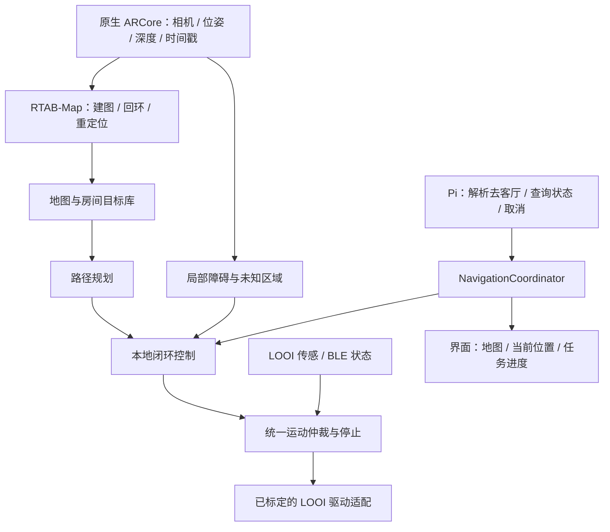

# 小米 12 Pro + LOOI：先用手机做房间地图与导航

研究日期：2026-10-30（Asia/Shanghai）。状态：**选型与原型计划，不是已交付的导航功能**。后续 A 阶段视觉探针开发记录见 [探针说明](NAVIGATION-PROBE.md)。

## 1. 建议与目标

先不买 USB 雷达。首选验证 **ARCore 视觉惯性定位（VIO）+ 深度观测 + RTAB-Map 地图保存/重定位 + 本地路径规划与 LOOI 控制适配**。保留现有 TypeScript 界面和 Pi；采集、几何计算和持续运动控制进入 Kotlin/C++ 原生模块。

第一版体验：用户带小丫扫描一间房、命名“客厅/沙发旁”等位置；重开应用后先找回自己在旧地图中的位置，再按语音去指定地点。先做人工带领建图与已知区域导航，后做跨房间，不把自主探索全屋作为第一步。人体身份、声源定位和更换音色均不成为这条路线的依赖。

下面分别标明官方已支持、项目代码现状与本项目拟采用的设计。原型通过前，不承诺任意家庭环境中的通行能力或定位精度。

## 2. 当前确认到哪里

| 检查项 | 本次结果 | 意义 |
| --- | --- | --- |
| 官方机型名单 | Xiaomi 12 Pro 标注 Supports Depth API | 值得先用现有手机试；不等于这台系统已运行成功 |
| USB 手机 | ADB 可见连接设备 | 可继续做独立原型与能力探测 |
| AR 服务安装 | `pm list packages com.google.ar.core`、`pm path com.google.ar.core` 均未返回包/安装路径 | 当前用户未查到 AR 服务；尚未创建 ARCore Session |
| Google 基础服务 | 包查询返回 `com.google.android.gms` | 与 AR 服务是两个包，不能互相替代 |
| LOOI 身体 | 既往用户确认前后移动、左右转向、抬头和回正 | 证明基础动作可用，尚不提供连续定位或精确速度闭环 |
| 地图与导航 | 本仓库没有交付这套能力 | 此文不能改成“自主导航已支持” |

本次仅作只读包查询与源码研究，没有启动 AR 采集、安装第三方应用或移动底座。官方给出中国区通过包括小米应用商店在内的渠道提供 Google Play Services for AR 的说明；后续先检查官方商店在本机的实际可用版本，再通过 SDK 的安装/兼容性检查处理，不从不明 APK 站补包。[机型与中国区说明](https://developers.google.com/ar/devices/)、[安装与运行时检查](https://developers.google.com/ar/develop/java/enable-arcore)

基础对话应用应使用 AR Optional：没有 AR 服务时禁用导航入口并说明原因，不让聊天、媒体和已有底座控制无法启动。

## 3. 候选方案取舍

| 路线 | 能复用什么 | 本项目选择 |
| --- | --- | --- |
| ARCore + 自建轻量栅格/路线点 | 手机位姿、深度；采集原型较小 | 用于第一步能力验证和同会话演示；地图跨重启恢复还需另外实现 |
| **ARCore + RTAB-Map** | Android 相机适配、回环、地图数据库、定位模式 | **主候选**；先独立验证，再裁剪/接入原生库；不照搬完整扫描 App |
| OpenBot 手机机器人 | ARCore 点目标导航、手机与底盘分层 | 借鉴采集与接口组织；不直接复用其底盘固件和训练策略作为 LOOI 导航成品 |
| 手机采集 + 局域网电脑 RTAB-Map/Nav2 | 成熟建图、规划、调参可视化 | 可选开发验证环境；若最终依赖电脑运行，必须明确标注，不宣称是独立手机方案 |

RTAB-Map 的 Android `CameraARCore.cpp` 实际创建 ARCore 会话、查询深度模式，读取位姿/图像/深度；`RTABMapApp.cpp` 有地图数据库加载与 `setLocalizationMode()`。这是可以复用的源码基础，**不是接入 LOOI 后就能自动行驶**。[相机适配源码](https://github.com/introlab/rtabmap/blob/5241132372cbb26289ea9e3785f83c2485a30736/app/android/jni/CameraARCore.cpp)、[Android 应用核心](https://github.com/introlab/rtabmap/blob/5241132372cbb26289ea9e3785f83c2485a30736/app/android/jni/RTABMapApp.cpp)

核查时 RTAB-Map HEAD 为 `5241132372cbb26289ea9e3785f83c2485a30736`，OpenBot HEAD 为 `c5f05271a067ca83d3de38e5976fa07bcec74b6e`。后续原型固定经过验证的版本，不跟随 master 自动升级。RTAB-Map 该适配文件带 BSD 条款，OpenBot 仓库标注 MIT；接入时仍须逐项保留依赖许可与第三方声明。

OpenBot 的文档将 Point Goal Navigation 描述为相对当前位姿指定二维目标，并由 AI 策略尝试到达、避障；另明确提示预置 CIL-Mobile 策略可能不适合用户环境，需要训练。本项目不把这种策略直接当成通用、可保存的家庭地图导航。[OpenBot Android 功能与策略说明](https://github.com/ob-f/OpenBot/blob/c5f05271a067ca83d3de38e5976fa07bcec74b6e/robot/android/app/README.md)

不优先从裸相机/IMU 移植另一整套 VIO：先利用手机已适配的 ARCore，避免首步承担原始采样同步、标定与 Android 驱动适配。ARCore 实际不可用时再另做替代选型，不据此直接购买雷达。

## 4. 手机能提供什么，还缺什么

### 定位与深度

ARCore 用相机和运动传感器跟踪设备运动。Depth 可由运动估计得到，不要求手机有物理 ToF；官方说明约 0.5–5 米时更准确，移动通常有利于深度生成。这不是机器人近场全覆盖的保证。[Depth 原理](https://developers.google.com/ar/develop/depth)

原型同时比较平滑深度与 Raw Depth。Raw Depth 提供稀疏深度和逐像素置信度；纯色墙可能没有有效观测。同一张深度可能被重投影到后续画面，须记录深度时间戳，不能把重复数据当成不断更新的障碍观测。[Raw Depth 文档](https://developers.google.com/ar/develop/java/depth/raw-depth)

RTAB-Map 现有适配读取的是其深度接口，不应声称它已实现本项目拟采用的 Raw Depth 置信度过滤。增加此观测路径需要单独适配和验证；两种深度不一致时也不能简单选“看起来更满”的画面。

地图层拟以 5–10 厘米栅格作为初始实验配置，融合地面、障碍高度和当前观测，最终分辨率依实测误差与算力调整。无效深度、低置信度、视野之外保留为“未知”；只对有效观测经过的射线更新空闲区域，不把白墙深度洞或没看到的地方标成可走。

### 地图保存与重定位

ARCore 的局部位姿不等于持久化房间地图。普通 local anchor 仅在应用实例范围有效，不能只把当前位置数值写入 SQLite 就在下次启动继续使用。[Anchor 有效范围](https://developers.google.com/ar/develop/anchors)

拟由 RTAB-Map 保存关键帧、描述特征和地图关系；重新进入房间时匹配旧地图，再恢复“客厅”目标点。官方多会话教程展示了数据库与定位模式，但历史 Tango 示例不能替代本机 ARCore 验收。[官方多会话教程](https://github.com/introlab/rtabmap/wiki/Multi-Session-Mapping-with-RTAB-Map-Tango)

可选低成本辅助是在固定起点或房门放打印的 AprilTag，按已知尺寸估计相对位姿，为新会话对齐旧地图提供观测。图案位置必须登记且不能随意移动；遮挡或识别歧义时不采信。它只辅助定位，不代替障碍地图，不要求每个房间都贴。[AprilTag 官方项目](https://github.com/AprilRobotics/apriltag)

### LOOI 的真实接入边界

现有 [SDK](../mobile/packages/looi-sdk/src/index.ts) 可发送行驶/停止/头部位置命令；[控制层](../mobile/src/device-tools/looi-robot.ts) 有动作超时、停止流程与传感联锁；[FED9 解码](../mobile/src/device-tools/fed9-sensors.ts) 有四向悬崖标记及 provisional 前向 ToF。

尚未找到已实现的轮速编码器里程计、底盘位姿或可用于外参更新的真实头部关节角反馈。头部命令值不等于反馈角度；定时转向也不等于已知转角。社区传感标定不代替这台底座的方向、单位、刷新率与无效值验证。

没有编码器仍可试视觉里程计闭环。Nav2 官方也介绍用 VIO 替代或补充轮式里程计；这只证明接入路线成立，不证明 LOOI 的当前时延和命令精度达标。[Nav2 VIO 接入](https://docs.nav2.org/jazzy/tutorials/general_tutorials/integrating_vio/integrating_vio/)

## 5. 必须先测的三个安装问题

1. **后摄方向与行驶视野。** 实测后摄光轴、底盘“前进”与 ToF 朝向。屏幕朝向用户时，不能假设后摄也朝底盘前方。整机原地转 180 度不会改变摄像头相对车身的方向；直接用倒车代替前进还会改变保护传感器覆盖。先完成安装/运动方向标定，观测不到的行驶区域不开放自主通行。
2. **头部俯仰。** 首版导航固定头部与手机安装角，暂停表情带动的抬头/点头。否则相机移动混入底盘运动，外参随时间变化。需要活动头部时，必须先补可靠关节反馈和标定。
3. **相机所有权。** 导航优先由 ARCore 持有后摄，其他视觉先复用它的 CPU 图像。前摄 ARCore 模式不会提供同样的世界运动跟踪；不能把前摄注视当成 VIO。拍照/录像需切相机时先停车，恢复后重新验证定位。前后双摄并发与 Camera2 SharedCamera 另测；官方明确共享模式不能利用硬件深度传感器，不据此推断所有软件深度都不可用。[前摄限制](https://developers.google.com/ar/reference/java/com/google/ar/core/CameraConfig.FacingDirection)、[共享相机限制](https://developers.google.com/ar/reference/java/com/google/ar/core/SharedCamera)

特别记录地面附近视野：电线、矮物、桌腿、玻璃/镜面、纯色墙、暗处与运动中的人。手机深度不足半米时的表现必须测，不能让 0.5–5 米的典型范围掩盖刹停区域的盲区。

## 6. 拟采用的模块边界

这是拟建架构。现有通用运动控制还没有完成导航所需的原生时效闭环与运动仲裁扩展。

- **Kotlin**：ARCore 生命周期、相机切换、帧时间戳、原生状态机、平台与连接状态事件。
- **C++**：优先复用 RTAB-Map；涉及深度点云和地图时通过 JNI 接入，原始帧不逐帧穿过 JavaScript 桥。
- **TypeScript**：地图命名、目标管理、Pi 工具协议和低频状态展示；不承担每帧障碍处理和持续制动时限。
- **规划/控制**：首轮用录制数据与局域网电脑验证成熟算法；手机独立版再明确可裁剪组件或有限栅格规划/路径跟踪器。不能先宣称 Nav2 整套可直接装入 APK。
- **Hermes**：可分析诊断、离线整理地图数据，不接管实时电机循环。云端断网不应妨碍手机停车。

地图数据库与目标语义分开保存：`mapId/mapVersion`、地图文件、关键帧/地标关联、`placeId/name`、目标姿态、有效定位状态。回环优化或换地图后同步更新目标关联；不长期保存一组脱离地图版本的裸坐标。

统一坐标约定，明确 ARCore/OpenGL 与机器人坐标轴转换。定义 `T_A_B` 为把 B 坐标变到 A，则 `T_map_base = T_map_camera × inverse(T_base_camera)`；首次固定外参，后续关节变化才引入动态外参。ARCore 位姿发生校正/跳变不能直接当成瞬时速度；地图校正与连续运动估计分开处理。

Pi 最终只注册通过验收的高层工具，例如 `navigation_status()`、`navigate_to_place(placeId, mapVersion)`、`cancel_navigation(taskId)`。建图和保存目标有单独的交互流程；不允许模型以不断调用“向前五秒”代替路径控制。

状态机拟为 `IDLE → MAPPING / RELOCALIZING → READY → NAVIGATING → ARRIVED`；定位丢失、观测失效、相机切换或障碍阻断进入 `PAUSED/STOPPED` 并说明原因。恢复资源后先核验位置和路径，不自动重发旧速度。

现有连续动作的 `CONTINUOUS_MOTION_DEADMAN_MS = 5000` 是通用动作边界，**不是导航可接受的失观测继续行驶时间**。导航要按实测速度、停止距离、BLE 时延和观测更新制定更短的指令有效期，并使停车检查不依赖 JS 界面流畅；具体时限在台架数据后确定。底座断连后的停止行为须实测，手机本身无法保证断开后发出 STOP。

## 7. 按依赖交付与验收

以下数字是拟定的测试规模，不是已达到的性能。

| 步骤 | 实际交付 | 如何决定进入下一步 |
| --- | --- | --- |
| A：手机能力探针 | 独立原生调试页：AR 服务状态、后摄配置、AUTOMATIC/RAW_DEPTH_ONLY 支持、位姿轨迹、深度/置信度预览、诊断导出；不写电机 | 成功创建 Session 并持续输出；记录无光/遮挡/暂停时的真实状态，能区分不支持与暂未生成深度 |
| B：单房间建图 | 固定安装角；人工带领或已有短动作遥控，采集真实底座高度视野；保存地图和命名点 | 量测房间已知距离，比较闭环轨迹漂移；连续运行 15–20 分钟记录温度、帧率和深度新数据率；识别观测盲区 |
| C：重启找回位置 | 加载旧地图，显示当前位置；必要时固定起点图案辅助；仍不自动移动 | 至少 10 次分布于不同起点/朝向的重定位记录，包含相似角落、照明变化和失败样本；失败不能误报定位成功；定位误差小于实际通道余量要求 |
| D：单房间到点 | 标定行驶响应、速度/停止距离，统一运动仲裁；先短直线目标，再增加转弯 | 重复记录到点误差、停车距离、人工干预；遮挡相机、暂停 App、BLE 异常均有可复核停止结果；不是只看模型回答“到了” |
| E：房间间导航 | 房门连接关系、走廊路线、临时障碍处理、客厅到达点 | 至少 10 轮实际跨门路线记录；门槛/地毯不能通过时报告受阻，不反复冲撞；新增路线逐条开放 |

保留时间同步的位姿、图像/深度、传感原始帧、命令、状态变化与实际测量，失败能离线回放。首次先量基线，再确定速度、置信度和允许误差，不拿某个示例阈值作为整屋通用标准。

首个开发包应只完成 A，让手机证明服务、VIO 和深度确实可用；通过后立即进入 B/C，而不是直接把自主运动开关放进正式版。现有聊天、媒体、相机功能须继续保留；视觉资源冲突的暂停行为也是验收项。

## 8. 何时才考虑增加传感器

| 实测瓶颈 | 优先处理 | 再考虑什么 |
| --- | --- | --- |
| AR 服务未安装、会话配置失败 | 官方安装渠道、版本与配置修正 | 这是软件前置问题，不构成买雷达理由 |
| 旧地图难以重定位 | 改善采集、增加回环、固定起点/图案辅助 | 仍不足时再研究其他定位来源 |
| 暗光/无纹理导致持续失踪 | 测试照明与实际路线限制 | 需要这些环境也能工作时，才评估补充传感器 |
| 前后摄方向或近场低矮障碍覆盖不足 | 安装/视野验证，明确可行驶方向 | 按盲区选测距/深度方案，不能假定单个平面雷达覆盖所有高度 |
| 手机持续计算降频 | 降采样、减少关键帧、裁剪组件；用现有电脑对比 | 确有必要才评估协处理器 |

即使之后增加 USB 雷达，Android 驱动、USB 供电/充电、安装空间和坐标标定仍须验证；2D 雷达也不自动解决门槛、悬崖、上方碰撞或底座机械通过性。采购应对应已测出的瓶颈。

## 9. 本次结论与尚未完成项

**有合适的手机优先路线，最适合本项目的主候选是 ARCore + RTAB-Map；先“带领建图、命名、重启定位”，再“到点、跨房间”。** OpenBot 可借鉴，局域网 Nav2 可辅助原型，均不代替 LOOI 适配和实机验证。

研究时完成官方资料/相关源码核查、只读手机包检查和方案细化；当时尚未完成 AR 服务安装和能力探针。后续实际开发状态以 [探针说明](NAVIGATION-PROBE.md)与版本验收记录为准。地图生成、重定位和自主行驶仍是下一步；基础动作已验证与自主导航待开发这两个状态必须分别保留。

用户随后确认后摄朝后，提出倒车行驶、到点再转身面对用户，作为后续原型的首选行驶策略。机身可转向与不能单独摇头分别建模；倒车近场观测、停止距离和转身扫掠范围须先标定，详见探针说明。
