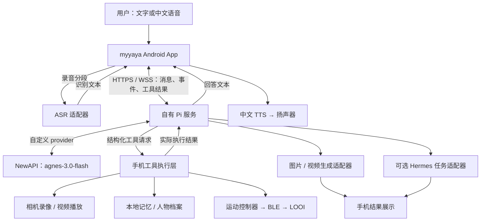

# myyaya 采用 Pi 的实施方案

日期：2026-10-26。状态：方案与接口预验证完成，Pi 尚未接入应用；没有部署服务，也没有生成新的 APK。

本方案承接 [总体需求](PLAN.md)，保留小米 12 Pro / 澎湃 OS 3 + LOOI + 自有 Android APK，采用 Pi 作为任务理解和工具调用的核心。接口实测单独记录在 [模型测试记录](MODEL-PROBE-2026-10-26.md)。

2026-10-27 补充：[APK 开工方案](APK-DEVELOPMENT-PLAN.md)将本方案细化为手机基线、媒体工具和 Pi 对话三批验收，补充 V1 手机桥、取消/恢复语义及源码中音视频和后台退出的实际约束；新增协议仍为开发草案。

同日用户新增的媒体交互、固定唤醒、童声、任务框与导航需求见 [产品基线](PRODUCT-REQUIREMENTS.md)。语言选型、Viewer、异步 JobWorker、Hermes 能力发现和新 S0–S6 顺序以 [修订架构](ARCHITECTURE.md)为准；本文件的 P0–P7 保留作技术工作分解。上游 Key 门槛已在源码修复，新版 Pi 会话仍未实现。

## 1. 结论与运行位置

已有需求中，中文问答、手机录像与播放、看图、长期记忆、内容展示、服务器任务和 APK 在线升级具有明确实施路径。人脸身份、中文昵称唤醒和转向看人需要专项实测；“过来”涉及距离、障碍和路径，保留为独立后期目标。

首版采用 **手机 App + 自有服务器上的 Pi 服务**。手机保留社区项目的界面、音频、相机、记忆和 BLE；Pi 服务调用 NewAPI，并把手机工具请求发回 App。开发阶段可在当前电脑运行服务，正式使用需要可访问的在线服务；优先复用已有服务器，当前不要求购买另一套机器人硬件。

这一选择增加了一个运行 Pi 的服务。完整 Pi 任务依赖该服务在线；手机可另设直连 NewAPI 的纯问答降级模式，手机本地录像按钮、视频播放和紧急停止保持可用。Hermes 是可选任务后端，基础问答与手机工具不依赖它。

手机直接内嵌 Pi 列为后续优化：先做独立 Expo / React Native demo，验证 Metro 打包、Hermes JS 引擎、网络流、取消和工具循环，再决定是否迁回手机。官方 browser 支持不能直接等同 Android React Native 支持。[Pi browser 说明](https://github.com/earendil-works/pi/blob/v1.4.0/packages/ai/README.md#browser-usage)

## 2. 使用哪部分 Pi

官方旧地址 `badlogic/pi-mono` 当前重定向到 `earendil-works/pi`。研究基线固定为正式版本 **v1.4.0**，tag 提交 `4a080252f06caf63a525d7873c5d94d3c23887e0`，不跟随 main 自动更新。[正式发布](https://github.com/earendil-works/pi/releases/tag/v1.4.0)

| 组件 | 在本项目中的职责 |
| --- | --- |
| `@earendil-works/pi-ai@1.4.0` | 自定义 provider、模型协议、消息和流式输出 |
| `@earendil-works/pi-agent-core@1.4.0` | 对话状态、工具循环、进度事件和取消 |
| 自建 Pi 服务，Node.js >= 22.19 | 会话 API、手机连接、工具注册、任务记录和访问认证 |
| My LOOI 社区 Android 基线 | 表情与 UI、音频采集/播放、相机基础、SQLite、BLE 和更新安装 |

只引入这两个 Pi 核心库，手机工具由本项目定义。服务不加载 coding-agent CLI 的默认终端和文件编辑工具。现阶段使用自己的 SQLite 任务表和事件日志；Pi 的 `pi-durable` 仍标为实验性，不作为首版必需依赖。[Agent 文档](https://github.com/earendil-works/pi/blob/v1.4.0/packages/agent/README.md)、[包运行要求](https://github.com/earendil-works/pi/blob/v1.4.0/packages/agent/package.json)、[durable 状态](https://github.com/earendil-works/pi/blob/v1.4.0/packages/durable/README.md)

## 3. 数据与任务如何流转



手机主动建立出站连接，不需要给手机开放公网端口。图中的 ASR / TTS 是独立适配器；首版 ASR 可以通过服务调用用户的转写接口，TTS 优先验证手机系统已安装的中文语音。需要更换音色时再接经验证的服务端 TTS。

社区原有 OpenAI Realtime 保留为独立的可选模式，新增 `Pi + ASR + TTS` 会话模式。一次只启动一个会话控制器；Pi 模式的工具和记忆统一由 Pi 路径调用，避免两套对话同时监听和执行。

## 4. 模型分工与当前证据

| 用途 | 首选候选 | 当前证据与边界 |
| --- | --- | --- |
| 主对话、任务理解、工具选择、看图 | `agnes-3.0-flash` | HTTP 文字、SSE、一次原生函数调用及结果续答、合成图片输入通过；尚未验证 Pi SDK 完整闭环 |
| 语音识别 | `TeleAI/TeleSpeechASR` | `/v1/audio/transcriptions` 接收 WAV；一段合成中文指令识别成功，昵称出现同音字；真实远场语音未测 |
| 图片生成 | `agnes-image-2.5-flash` | `/v1/images/generations` 生成一张图片并下载到有效 PNG；与普通聊天分开 |
| 视频生成 | `agnes-video-2.5` | 模型列表可见；尚未验证提交、状态查询和结果协议，暂不开放正式工具 |
| 中文朗读 | 首选童声候选 Azure `zh-CN-XiaoyouNeural`；系统中文 TTS 降级 | 用户本次要求可爱童声；候选需独立 Speech 凭据和试听，尚未接入。系统音色/离线/打断需真机测；现有社区旧 `tts.ts` 已退休 |

NewAPI 地址配置为 `https://apichat.jiazhuangai.com/v1`，自定义 provider 名建议为 `myyaya-newapi`。模型 ID 按接口返回原样使用；不根据 `agnes` 名称推断其背后的厂商或真实模型。

Pi provider 使用官方 `createProvider()` 与 `openAICompletionsApi()` 路径；参数兼容项、工具 schema 和流式工具参数必须通过 SDK 实测确定。图片、视频与转写由独立工具适配器负责，不能都发往聊天端点。[Pi provider 文档](https://github.com/earendil-works/pi/blob/v1.4.0/packages/ai/README.md#custom-providers)

## 5. 原有需求逐项落地

| 需求 | 可复用基础 | 计划新增与验收 |
| --- | --- | --- |
| 中文语音问答、打断 | PCM 采集、AEC、VAD、音频输出、状态 UI | 新中文 ASR→Pi→TTS；播放自己声音不误唤醒；打断后不续播过期回答 |
| 开始/停止录像 | 权限、相机拍照基础 | 新录像模块与索引；说“开始录像”，再说“停止录像”，得到可播放且有声音的视频 |
| 找到并播放录像 | SQLite、文件系统 | `mediaId` 索引、最近/日期查找、视频播放器；暂停、继续、停止；重启后仍能查找 |
| 手机已有视频 | 系统照片选择器基础 | 首先支持用户手动选中的视频；不默认扫描整个相册 |
| 相机看图问答 | 前后镜头拍照、照片选择 | 拍一张图交给多模态模型；拒绝权限或图像不清时如实反馈 |
| 长期记忆、角色与偏好 | 社区本地 SQLite、搜索与角色配置 | 复用同一份记忆；新增中文检索适配，提供保存、修改和删除，避免 Pi 另建一套相互冲突的事实 |
| 表情与任务进度 | 眼睛、表情和会话 UI | 监听、思考、说话、录像、执行、失败状态由真实事件驱动 |
| 网页、图片、PDF、Word、视频 | 部分图片与浏览器基础 | 统一结果页；PDF/网页/媒体预览，Word 由可用服务转换后预览或交给外部应用 |
| 联网搜索、文件与复杂任务 | 原需求中的 Hermes 服务 | 核对真实接口后封装 submit/status/cancel/events/artifacts；基础功能不等待 Hermes 接通 |
| Hermes 工作过程画面 | 待核实 | 有事件先显示事件；有实际画面流才接 Screen，不把日志当作真实屏幕画面 |
| 生图、生视频 | NewAPI 候选模型 | 各自工具和产物索引；视频先验收异步协议，生成视频与手机录像分开处理 |
| 昵称唤醒、看向人 | 本地 KWS/Whisper、脸框、social-attention | 补中文昵称及别名、视野目标选择；低速有限转向，找不到人及时停止 |
| 认人、记住人 | 人脸检测/跟踪和声纹模块基础 | 新人物登记、embedding 与身份匹配；区分已登记人和陌生人，不把脸框当作身份 |
| “过来” | BLE 限时运动基础 | 后期增加可靠距离、障碍与路径验证；现阶段不注册自主追人/导航工具 |
| 日常 APK 在线升级 | 自有更新源和校验安装模块 | 首个永久签名 APK，再从 n 升级 n+1，保留设置、记忆和录像索引，无需 USB |

ML Kit 的脸框检测/跟踪与人物身份识别是不同能力。[官方能力说明](https://developers.google.com/ml-kit/vision/face-detection)

## 6. 手机工具与执行规则

第一批工具计划如下；实际模型工具注册名使用下划线，按 provider 规则校验，不把手机内部的点式 action 直接当作函数名。

| 工具 | 返回结果 |
| --- | --- |
| `device_get_status` | 当前连接、权限、录制/播放状态与支持能力 |
| `camera_start_recording` | 实际 `recordingId`、开始时间和录制状态 |
| `camera_stop_recording` | 保存结果、`mediaId`、时长；未录制时返回明确状态 |
| `media_find` | 候选 `mediaId`、时间、时长；有歧义时由用户选择 |
| `media_play`、`media_pause`、`media_resume`、`media_stop` | 实际播放器状态及播放位置 |
| `vision_capture` | 单次图片引用；按当前任务发送，不持续上传相机画面 |
| `memory_search`、`memory_remember`、`memory_update`、`memory_forget` | 本地执行结果与记录 ID |
| `robot_stop`、`robot_look`、`robot_move_limited` | 由现有运动控制器校验后执行；未验收的动作不注册 |
| `task_submit`、`task_status`、`task_cancel` | Hermes 或媒体任务 ID、真实状态和产物引用 |

手机工具通过 `deviceSessionId / taskId / toolCallId / requestId / deadline / action / args` 定位。结果包含 `running / succeeded / failed / cancelled`、实际结果和可解释错误。App 在配对后只接收当前设备会话的允许工具，校验参数、权限、支持能力与过期时间；设备凭据与模型 Key 分开保存。

重复 `requestId` 返回原状态，不重复开始录像；断线重连不重放过期动作。录像与运动等有副作用工具不做盲目重试。媒体用 `mediaId` 引用，不让模型拼接任意手机路径。手机工具串行协调；只把独立读取类请求并行处理。

Pi 的取消只负责取消任务流；各工具仍需响应取消信号并落实资源清理。录像停止后等待文件保存成功才报告完成。**紧急停止直接走手机本地控制器，不等待模型、服务器或正在运行的工具批次。** Pi 的 `steer()` 不能代替急停。[取消和工具执行机制](https://github.com/earendil-works/pi/blob/v1.4.0/packages/agent/README.md)

初始建议限额：普通任务最多 6 轮模型调用、10 次工具调用、90 秒总时限，随后按实测调整。生成媒体等长任务单独持久化、返回任务 ID 并设置独立超时；提交超时先查原任务，不自动再次扣费生成。成本、耗时和失败原因显示在任务详情，不伪造百分比进度。

## 7. 优先解决相机和麦克风竞争

录像是第一批硬件验证项，不能在最后才发现资源冲突。

- 相机由一个资源管理器分配。首期录像时暂停人脸跟随/单拍；录像结束归还相机后恢复。社区已有 Camera2 模块，新录像模块不能另开一路抢占。后续若需边录像边检测，验证同一相机会话的组合支持。
- 麦克风优先尝试统一 PCM 采集，分别送 ASR 与录制音轨编码器；需要原生录制/封装适配。若使用自带音频采集的 Recorder，必须单独证明它与命令识别可以共存。
- 验收必须包含**有声音的视频录制期间，说“停止录像”仍然有效**。UI 停止按钮与时长上限同时保留；静音录像通过不等于本项通过。
- TTS、视频播放、语音识别和唤醒共用音频焦点与状态控制，避免机器人把自身播放当作新指令。
- 首版以 App 前台可见运行为验收范围；锁屏/后台相机、麦克风和唤醒以后按手机系统权限单独验证。

依据：[Android 音频输入共享](https://developer.android.com/media/platform/sharing-audio-input)、[CameraX use case 组合](https://developer.android.com/media/camera/camerax/architecture)、[前台服务与后台启动限制](https://developer.android.com/develop/background-work/services/fgs/restrictions-bg-start)。

## 8. 记忆、人物与任务数据

手机本地 SQLite 继续负责聊天、偏好和手机媒体索引。计划增加 `people`、`person_profiles`、`media_items`、`recording_sessions`，以及人物与记忆的关联；具体表结构在实现前先核对社区 schema，采用迁移保留原数据。

中文检索要先做适配。现有 FTS5 使用 `unicode61`，查询主要按空格拆词，小记忆库还依赖最多 48 条 / 12,000 字符的全量兜底，不能视为可靠的中文检索。先验证中文分词后的关键词索引与有界原文检索，再评估 trigram 或 embedding；不能假设手机 SQLite 已提供特定 tokenizer，或 NewAPI 已有可用 embedding 模型。验收至少保存 80 条中文记忆，重启后用改写问法找到相关事实，更新/删除后不返回失效内容。

人脸 embedding 和声纹模板优先放在本机；登记由用户明确发起，提供删除入口。普通问答只提供必要的记忆检索结果。模型看图时单独发送当次图片；不为接入 Pi 上传整个相册或完整人物数据库。

服务端保存 `tasks`、`task_events`、`tool_requests`、`artifacts` 等恢复所需数据。Pi core 的内存会话不能替代持久任务记录。断网后按任务 ID 查询真实状态；“取消已申请”与“后端已停止”分别显示。Hermes 仅在确认真实 API、认证及取消语义后接入，不假设任何现成路由。

服务端产物保存 MIME、大小、来源任务、过期时间等信息；下载/预览只处理允许的协议与内容类型。网页和文件内容作为任务数据，不具有修改设备权限的地位。

## 9. 开发顺序与每步完成条件

| 步骤 | 工作 | 完成条件 |
| --- | --- | --- |
| P0 方案与协议预验证 | 社区审查、Pi 官方版本核对、少量 NewAPI 测试 | 本文与测试记录；已完成，不代表 SDK 已接入 |
| P1 Pi 最小服务 | 锁版本、自定义 provider、中文文本、假工具、事件与取消 | Pi SDK 实际完成两步工具任务；流式工具参数、取消、超时与断线有结果 |
| P2 手机与签名基线 | 自己的构建、权限、中文设置、永久签名、手机工具桥 | 小米手机安装成功；本地按钮与假工具桥通过；OTA n→n+1 通过 |
| P3 录像/播放闭环 | 新录像模块、媒体索引、播放器、相机/音频协调 | “开始录像→停止→播放刚才视频→暂停→继续”全程通过；拒绝权限、文件丢失和重启可处理 |
| P4 中文语音与记忆 | ASR、系统 TTS、中文昵称与别名、打断、中文检索索引 | 在真实手机、近场/远场及播放声音场景验收；Pi 触发 P3 工具；80 条中文记忆的改写检索与重启通过 |
| P5 LOOI 实机 | 连接、状态、STOP、有限动作、社交跟随 | 固件记录、断连/传感器/急停测试通过；随后开放相应 Pi 工具 |
| P6 服务器任务与内容 | Hermes 适配、网页/PDF/Word、图片/视频生成 | 真实任务提交→进度→文件预览；失败、重连和取消均能解释 |
| P7 人物与扩展 | 人脸登记、人物记忆、多人选择；导航单独调研 | 两个登记人+陌生人测试；导航条件未达成时维持不支持状态 |

P2 与 P3 的麦克风/相机原型应尽早交叉验证；LOOI 到货前可完成 Pi 和手机部分，BLE 实机仍需自己的底座。阶段名是开发顺序，不作为发布版本号或工期承诺。

## 10. 拟增加的代码结构

以下目录尚未创建，实施时再落代码。

```text
agent-service/                  Node.js + Pi 服务
  src/providers/               NewAPI 模型配置与兼容
  src/device-bridge/           配对连接、工具下发和结果
  src/tools/                   手机、记忆、媒体任务工具
  src/tasks/                   持久任务和事件
  src/adapters/                Hermes / ASR / 图像 / 视频
mobile/src/agent/              手机连接、事件与会话模式
mobile/src/device-tools/       在现有目录扩展工具调度
mobile/src/media/              录像索引与播放器
mobile/modules/                新原生录像及音频协调模块
```

测试模型 Key 仅用于本次内存中的请求，未写入源码、文档、APK 或发布配置。正式服务的模型 Key 用私有环境配置；手机直连降级若启用，使用用户在手机输入并保存在 SecureStore 的 Key。公开 GitHub、日志和错误报告不包含凭据。

## 11. 更新方式

手机新增原生功能后仍需构建新版 APK，保持包名 `io.github.mypengpengli.myyaya`、永久签名一致，并提高 versionCode。用户在手机内下载和确认安装，日常无需连 USB；不能把普通 Android 更新描述为静默安装。[现有升级方案](UPDATES.md)

Pi 服务的提示词、模型路由与服务端工具适配可独立更新；涉及手机新权限、原生模块或工具协议变化时，需要匹配的 APK。协议带版本和设备能力协商，旧 App 不接收它不支持的工具。

当前仍缺首个签名 APK、手机真机验证、Pi SDK 集成、可用中文 TTS 评估，以及 Hermes 真实接口资料。规划已经覆盖这些缺口，不能把今天的 HTTP 接口测试当作整机功能完成。

注：本方案中的 Hermes 指用户的服务器任务智能体；React Native 的 Hermes JavaScript 引擎是另一个组件。
